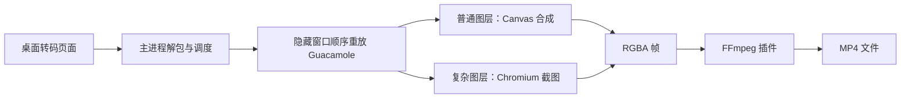

# 录像转码（Guacamole → MP4）

## 适用范围

本模块在 Electron 客户端中，将本地 `.tar` 包内的 Guacamole 图形录像导出为 MP4，包含录像中记录的软件鼠标。浏览器版和服务端不承担本地转码。

客户端使用者无需另装 Node、Go、Rust 或系统 FFmpeg。FFmpeg 不随主安装包分发，需在“设置 → 通用”安装当前平台对应的插件；正式转码只使用该插件，不查找系统 `PATH`。

## 模块与数据流



| 文件                                             | 职责                                                         |
| ------------------------------------------------ | ------------------------------------------------------------ |
| `ui/store/modules/transcode.ts`                  | 管理前端任务队列、转码选项及进度事件                         |
| `electron/src/desktop/main.ts`                   | 接入桌面命令，将请求交给转码器并转发进度                     |
| `electron/src/replay/transcoder.ts`              | 读取归档、管理隐藏窗口与 IPC、向 FFmpeg 写帧、处理输出和取消 |
| `electron/src/replay/replay-renderer-preload.ts` | 使用共享 Guacamole 引擎解析、重放、采样和取帧                |
| `electron/src/replay/codec.ts`                   | 计算输出尺寸及偶数对齐                                       |
| `electron/src/replay/ffmpeg-plugin.ts`           | 下载、校验和管理 FFmpeg 插件                                 |
| `electron/forge.config.ts`                       | 将转码 preload 作为独立构建入口打包                          |

隐藏窗口启用 sandbox 和 context isolation，关闭 Node integration。主进程检查转码 IPC 的来源窗口、主 frame、读取范围和像素长度；渲染进程通过专用通道按需读取录像数据。

## 输入与输出

### 归档格式

| 归档条目                             | 处理方式                                                           |
| ------------------------------------ | ------------------------------------------------------------------ |
| `<uuid>.<N>.part.gz`                 | 按数字序号排序，gzip 解压后拼接为 Guacamole 指令流                 |
| `<uuid>.replay.gz` / `<uuid>.replay` | 兼容压缩或未压缩的单段图形录像                                     |
| `<uuid>.replay.json`                 | 可选会话元数据，优先于其他 `.json` 条目                            |
| 其他 `.json`                         | 兼容元数据；缺失或 JSON 无效时，仍可使用归档文件名作为会话 ID 转码 |
| `.cast.gz` / `.part.cast.gz`         | 终端录像；没有图形录像时提示使用离线播放器                         |

归档中的嵌套目录不影响识别，条目不会按原路径解包到磁盘。元数据条目上限为 4 MiB，单个图形录像条目上限为 512 MiB；这是读取 tar 条目时的限制，不是解压后总数据量限制。

### 导出参数

桌面命令 `transcode_replays` 使用以下字段：

| 字段               | 含义                                                                                        |
| ------------------ | ------------------------------------------------------------------------------------------- |
| `tarPaths`         | 待处理归档路径，单批次按顺序转码                                                            |
| `outputDir`        | 输出目录，必须提供                                                                          |
| `filenameStyle`    | `original`、`friendly` 或 `friendly_uuid`                                                   |
| `outputResolution` | `original`、`p1080`、`p720` 或 `p360`，省略时为 `original`                                  |
| `transcodePower`   | `auto`、`full`、`fast`、`medium` 或 `low`；界面初始值为 `fast`，转码器省略参数时使用 `full` |

`original` 使用扫描得到的最大显示尺寸；其他分辨率仅在源画面超过目标高度时缩小，最后将宽、高向上取整到偶数，以满足 `yuv420p` 要求。小画面不会为匹配档位主动放大，奇数尺寸可能因偶数对齐增加 1 像素。

文件名默认使用会话 ID。`friendly` 使用“用户-资产-账号”，`friendly_uuid` 再附加会话 ID；所需元数据不完整时回退到会话 ID。已有同名文件时递增添加后缀。

输出固定为 **10 FPS、H.264（libx264 fast）、yuv420p、无音轨**，并设置 `+faststart`。码率为宽 × 高 × 5，限制在 800,000–20,000,000 bit/s。编码线程数按 `availableParallelism()` 乘以档位比例后四舍五入，至少为 1：`auto/full` 为 100%，`fast` 为 75%，`medium` 为 50%，`low` 为 25%。

## 重放、鼠标与画面一致性

### 时间线

渲染进程复用 `@jumpserver/guacamole` 的 `Parser`、`Client` 和 `Display`，分两遍读取指令，每次通过 IPC 读取最多 256 KiB：

1. 扫描默认显示图层的最大宽、高，以及首末 `sync` 时间戳；检查显示尺寸和时间戳的有效性。
2. 顺序重放完整协议帧，在应用下一个 `sync` 对应的指令之前，先输出该时间点之前的采样画面，避免提前显示后续鼠标位置或桌面内容。

首个 `sync` 映射为视频时间 0。首末时间戳之差为 D 毫秒时，输出帧数为 `ceil(D / 100) + 1`，最后保留录像末尾状态。导出不使用交互式播放器的 `SessionRecording.seek()`，因此不会为逐帧定位生成 PNG 快照缓存。

### 两条取帧路径

两条路径均先等待 `Display.flush()` 完成图片解码和绘图，并使用相同的黑色背景和输出缩放比例。

| 路径            | 选择条件                                                           | 取帧方式                                                                                                        |
| --------------- | ------------------------------------------------------------------ | --------------------------------------------------------------------------------------------------------------- |
| Canvas 内存合成 | 默认图层无子图层、整体 `alpha=255`、位置为原点且变换矩阵为单位矩阵 | 将已绘制的图层 Canvas 与独立软件光标合成到目标尺寸 Canvas，再读取 RGBA 像素                                     |
| Chromium 截图   | 不满足上述条件                                                     | 等待两次 `requestAnimationFrame`，由主进程 `capturePage()` 捕获实际 DOM 合成结果，归一化尺寸并将 BGRA 转为 RGBA |

Canvas 路径允许画面像素和光标自身带透明度，省去窗口绘制等待与截图开销。子图层移动、变换、父图层裁剪和组透明度交给 Chromium 处理；条件变化时可在两条路径之间切换。

截图使用普通隐藏窗口，设置 `offscreen: false`。此前离屏模式在取帧路径切换时出现过 Canvas 内容缺失，因此当前实现沿用播放器的普通窗口合成方式。导出也不使用会遗漏软件光标及部分 CSS 图层效果的 `Display.flatten()`。

### 鼠标与验证边界

鼠标图像、热点、坐标和显示状态沿用共享 Guacamole 实现。初始隐藏软件光标，录像中的 `mouse` 指令使其显示并更新位置；取帧时与背景一起缩放、裁剪。光标独立叠加，移动后不会写入或污染桌面图层。

只有录像中已有的鼠标信息才能导出，无法补回未记录的轨迹。这里的画面一致性指鼠标和图层的显示语义一致；缩放及 H.264 有损编码可能产生像素差异，端到端测试采用容差与播放器实际截图比较。

## 编码、资源和生命周期

渲染进程提交帧的起始索引、重复次数，以及 RGBA 像素或截图请求。主进程缓存当前帧，经 stdin 写入 FFmpeg；最多保留一个正在写入的批次，同时允许渲染进程准备下一帧。接收下一批之前等待上一批写入完成，结束前排空管道，写入期间不修改缓冲区。

纯 `sync` 心跳没有画面指令，可以复用当前帧并批量写入整个静止区间。其他指令按可能改变画面处理，不进行逐像素变化检测。帧队列不随静止时长增长，但归档各段解压后仍拼接并保存在主进程内存；256 KiB 分块读取用于避免渲染进程再复制整段录像，并不意味着全链路恒定内存。

每个文件拥有独立的隐藏窗口、IPC 通道和编码进程。IPC 活动及写帧会重置 60 秒超时；超时、渲染进程退出和 preload 错误均按当前文件失败处理。

编码先写入临时 MP4，成功后重命名为目标文件；失败或取消时终止 FFmpeg、移除临时文件，并释放窗口和 IPC。单个文件的解包、渲染或编码失败不阻止批次内其他文件；插件不可用或输出目录创建失败会直接使请求失败。

`cancel_transcode` 调用 `cancelCurrent(label)`，取消来源窗口正在处理的文件，随后可继续同批次的其他文件。转码器的 `cancel()` 则标记全部活动任务为取消，终止其窗口和编码进程，并停止后续文件。

## 进度和返回结果

主进程发送 `transcode-progress`，基础字段为 `file`、`index`、`total`、`progress` 和 `message`，按阶段附加 `metadata`、`success`、`output`、`duration`。

| 进度    | 含义                                                        |
| ------- | ----------------------------------------------------------- |
| `0`     | 归档读取后附带会话元数据，准备解压和转码                    |
| `5`     | 启动渲染窗口、扫描与准备                                    |
| `10–95` | 按已写入编码管道的帧数计算，按 0.1% 分段通知前端            |
| `100`   | 编码完成通知或最终结果；以包含 `success` 的事件判断文件终态 |

成功事件包含输出路径及耗时 `duration`（秒）；耗时覆盖渲染窗口启动至转码完成，不含此前的归档读取和解压。批量返回每个已处理文件的 `id`、`index`、`input`、`output`、`success`、`metadata`，失败时附加 `error`。

## 构建与验证

开发依赖按仓库要求准备，以下命令在仓库根目录执行：

```bash
pnpm typecheck:electron
pnpm test:electron
pnpm test:electron:transcode
pnpm electron:package:dir
```

`test:electron:transcode` 会先构建共享 Guacamole，再编译转码 preload 并实际导出 MP4。默认在临时目录安装 FFmpeg 插件；设置 `REPLAY_TEST_FFMPEG` 可仅在测试中使用指定的本地可执行文件，正式客户端始终使用已安装插件。

验证覆盖归档兼容和元数据回退、输出尺寸、重复文件名，以及光标图像、移动、热点、显示时序、越界裁剪、路径填充、子图层变换、透明度、父图层裁剪和取帧路径切换。端到端测试同时比较原尺寸及缩放输出与播放器截图，并检查取消当前文件后继续下一文件、释放隐藏窗口和移除临时视频。

FFmpeg 插件当前固定为 6.1.1，安装位置为 Electron `userData/plugins/ffmpeg/` 下的版本和平台目录。下载器支持镜像与源站回退，流式校验下载文件 SHA-256，解压并执行版本检查后写入插件 manifest。版本、目标与校验值维护在 `electron/src/replay/ffmpeg-plugin.ts`，升级时需同步更新支持平台并验证插件安装与转码。

## 附录：性能基准记录

以下为 **2026-11-22 在 macOS arm64 上的手工对照记录**，用于说明取帧策略的开销，不是自动性能回归测试或固定提速承诺。

对同一段实际录像的前 60 秒指令补齐末尾心跳，统一为 2380×1532、601 个首尾采样帧。三个实现均使用 FFmpeg 6.1.1、10 FPS、libx264 fast、2 个编码线程及相同码率，串行运行两轮。自定义像素重建参考实现仅在测试副本中统一输出尺寸与首帧采样，因此未包含旧版按 16 像素对齐而引入的额外缩放开销。

| 对照实现                           |   第一次 |   第二次 |
| ---------------------------------- | -------: | -------: |
| 自定义 Buffer 像素重建参考实现     | 22.30 秒 | 22.47 秒 |
| 顺序重放、变化画面逐帧截图参考实现 | 17.41 秒 | 17.33 秒 |
| 当前 Canvas 取帧与编码重叠实现     | 10.85 秒 | 10.77 秒 |

逐帧截图参考实现捕获 382 个变化画面，其余采样复用：绘制等待约 5.6–5.8 秒，截图约 5.1–5.2 秒，NativeImage 像素读取约 0.8 秒。当前实现同样读取 382 个变化画面，内存合成与读取约 3.4 秒，并与编码管道写入重叠。编码管道等待包含并行工作时间，各阶段耗时不能直接相加。

该片段耗时相对逐帧截图参考实现降低约 38%，相对自定义像素重建参考实现降低约 52%。前者用于比较取帧策略，后者并不具备完整鼠标及图层语义，不能作为画面正确性基准。复杂图层仍需实际 DOM 捕获，整段录像的收益取决于画面内容、分辨率和机器配置。
